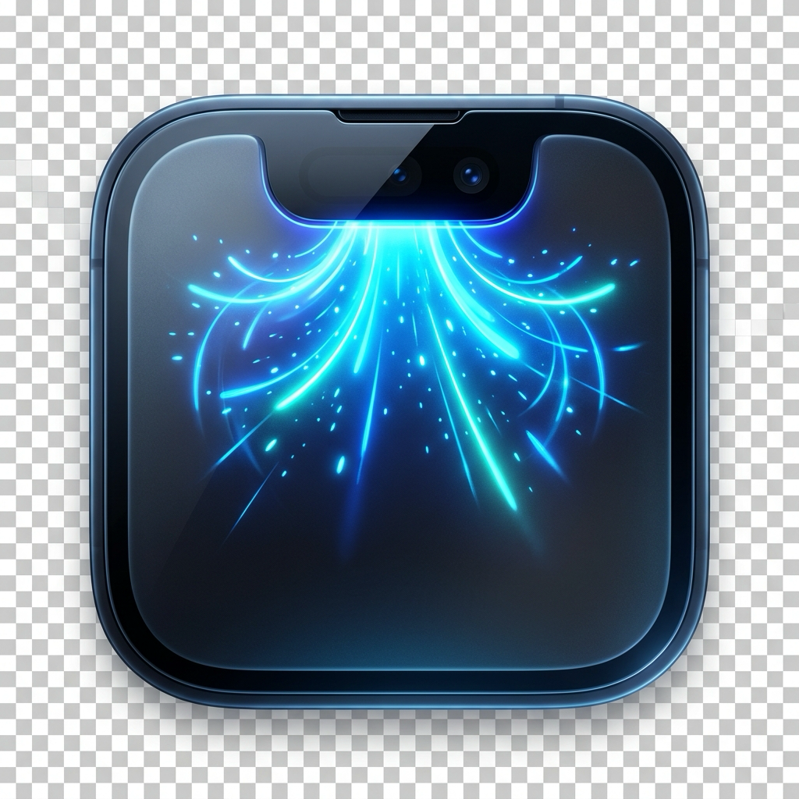

  <h1>Notchy</h1>
  
<b>The all-in-one dynamic notch utility for macOS</b>

  <a href="https://github.com/Yugpatel-09/Notchy/releases/latest" style="text-decoration: none; margin-right: 10px;">
    

      Download Notchy (.dmg)
    

  </a>
  <a href="https://github.com/Yugpatel-09/Notchy" style="text-decoration: none;">
    

      GitHub Repository
    

  </a>

 

**Notchy** is a sleek notch utility that displays current activities, live widgets, and media controls neatly around the notch on MacBooks. It features an integrated suite of convenient tools, from nearby sharing and quick file shelves to an advanced window snapping system and multi-output audio controls.

## Installation

1. **Download:** Download `Notchy.dmg` from the repository or [releases page](https://github.com/Yugpatel-09/Notchy/releases/latest).
2. **Install:** Open `Notchy.dmg` and drag **Notchy** into your **Applications** folder.
3. **Permissions:** On first launch, grant Accessibility and Screen Recording permissions in `System Settings` to unlock notch overlays and media controls.

## Features

  

    <h3 style="margin-top: 0;">Now Playing</h3>
    
Displays currently playing media and album artwork directly inside the notch with interactive playback scrubbers.

  

  

    <h3 style="margin-top: 0;">Nearby Share</h3>
    
Allows sharing files, pictures, videos, websites, and more seamlessly between devices and your Mac.

  

  

    <h3 style="margin-top: 0;">Advanced Audio Controls</h3>
    
Adjust individual app volumes, device volumes, app EQs and device EQs right from the notch.

  

  
  

    <h3 style="margin-top: 0;">Snap Zones</h3>
    
Versatile and customizable window snapping system with intuitive keyboard shortcuts and snap presets.

  

  

    <h3 style="margin-top: 0;">Weather</h3>
    
Live meteorological updates, conditions, and forecasts persistently accessible from the notch.

  

  

    <h3 style="margin-top: 0;">File Shelf</h3>
    
Quick drag-and-drop landing pad to store files, links, and temporary documents easily.

  

  

    <h3 style="margin-top: 0;">Calendar & Timers</h3>
    
Upcoming meetings, schedule previews, and precision timers right at the top of your display.

  

  

    <h3 style="margin-top: 0;">Lock Screen Widgets</h3>
    
Persistent widgets and controls that remain visible even when your Mac is locked.

  

  

    <h3 style="margin-top: 0;">Caffeinate</h3>
    
Prevent your Mac from sleeping during long downloads or presentations with a single tap.

  

